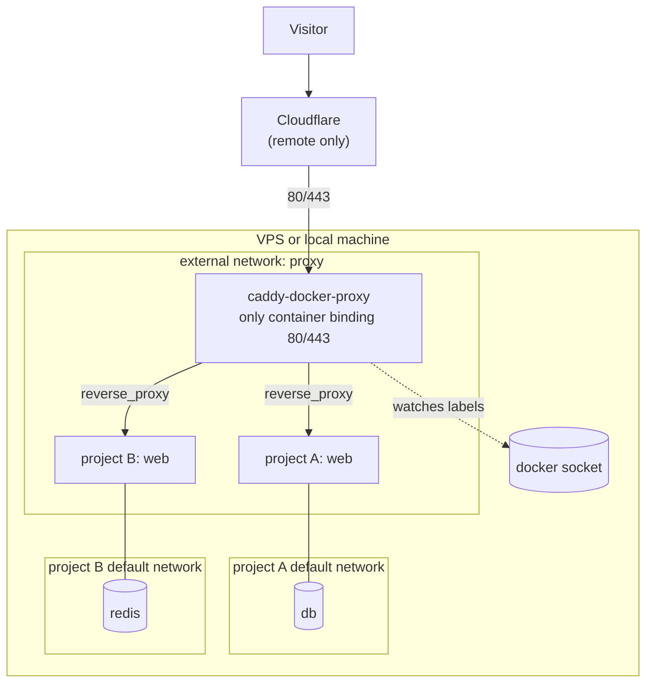
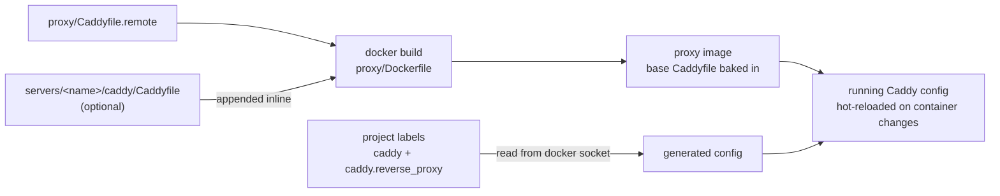
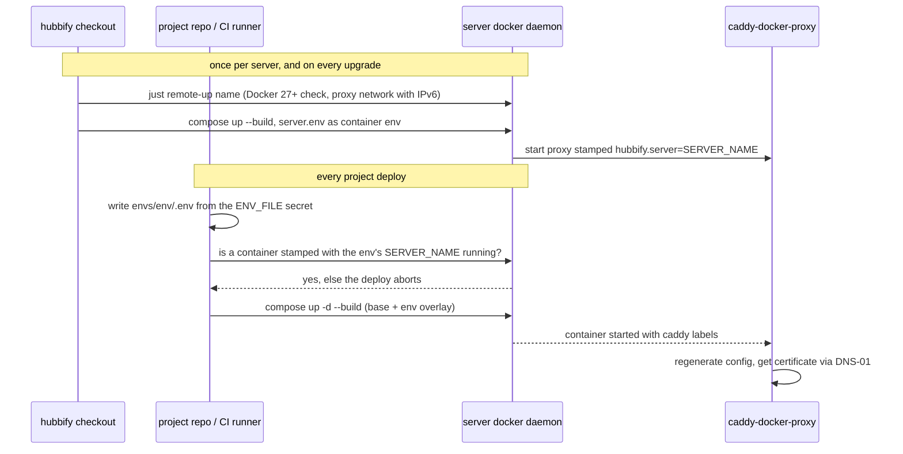
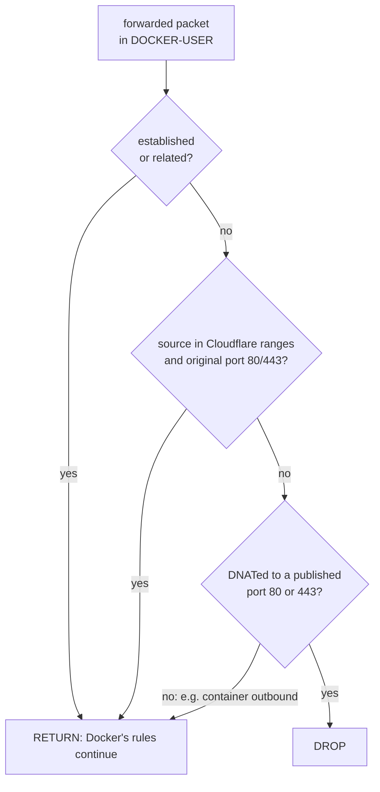

# Architecture

Hubbify is a toolkit to set up and maintain VPS servers that host
docker-compose projects behind a single reverse proxy. The same setup runs
locally (for development) and remotely (on the server), so there is exactly one
config language and no generation step.

## The big picture



## Reverse proxy

The proxy is [lucaslorentz/caddy-docker-proxy](https://github.com/lucaslorentz/caddy-docker-proxy):
Caddy custom-built (see `proxy/Dockerfile`) with three modules:

- **caddy-docker-proxy** — watches the docker socket, builds a Caddyfile in
  memory from container labels, and hot-reloads Caddy when containers change.
- **caddy-dns/cloudflare** — solves ACME DNS-01 challenges against Cloudflare
  (remote only).
- **caddy-cloudflare-ip** — provides Cloudflare's IP ranges, refreshed by the
  module, as a `trusted_proxies` source (remote only).

Projects declare their routing with exactly two labels (see
[project-contract.md](project-contract.md)); nothing else is allowed in labels.
Anything more complex goes into the base Caddyfile that caddy-docker-proxy
merges with the generated config:

- `proxy/Caddyfile` — local base (empty; escape hatch only).
- `proxy/Caddyfile.remote` — remote base (ACME email, `acme_dns cloudflare`,
  Cloudflare `trusted_proxies`).
- `servers/<name>/caddy/Caddyfile` — optional per-server extras (auth,
  headers, redirects for the sites that server hosts), as plain Caddyfile.

The base Caddyfiles are baked into the proxy image. On `just remote-up`,
`proxy/compose.remote.yml` passes `servers/<name>/caddy/` as an extra build
context, and `proxy/Dockerfile` appends its `Caddyfile`, when present, to the
end of `Caddyfile.remote`; without one the remote base is used as is. The
blocks are appended inline rather than imported because caddy-docker-proxy
does not expand `import`, and a block for a label-generated domain is merged
with that site like any other base-Caddyfile block.



## TLS

- **Locally** every project uses a `<name>.localhost` domain. Caddy serves
  these with its internal CA, so dev traffic is real HTTPS. `just trust`
  installs that CA in the WSL/Linux store and, when available, the Windows
  user store, so browsers accept it.
- **Remotely** all certificates are issued via DNS-01 through Cloudflare
  (`CLOUDFLARE_API_TOKEN` from `servers/<name>/server.env`, injected into the
  proxy container at deploy). This works behind Cloudflare's proxy (orange
  cloud) and needs no port-80 challenge.
- **Cloudflare zones must use SSL/TLS mode "Full (strict)".** Caddy holds
  real certificates, and it redirects port 80 to HTTPS — under "Flexible"
  Cloudflare fetches the origin over plain HTTP, which loops on that
  redirect (endless 308s).
- **Caddy sees the visitor, not Cloudflare.** `proxy/Caddyfile.remote` sets
  `trusted_proxies cloudflare` and `client_ip_headers CF-Connecting-IP`, so
  `{client_ip}` and access logs show the visitor for requests that arrive
  from Cloudflare's ranges; requests from any other peer keep the peer's
  address. This holds on every remote server.
- **Cloudflare-only origin (opt-in).** On servers with `CLOUDFLARE_ONLY=true`,
  `just firewall` drops inbound 80/443 (TCP, and UDP 443 for HTTP/3) from
  anything outside Cloudflare's ranges. The origin IP is closed to everyone
  but Cloudflare once `just firewall` has completed with the flag set, which
  on a host with a global IPv6 address needs a `proxy` network with IPv6 (see
  Firewall). Closing 80 does not break renewal: DNS-01 needs no
  inbound challenge traffic. Servers that also host grey-cloud (DNS only)
  domains leave the flag empty and keep 80/443 open.

## Isolation

Each project keeps its own compose default network for internal traffic
(app ↔ db, etc.). Only the web-facing service additionally joins the external
`proxy` network. A project's default network (databases, workers) is not
reachable from other projects or from the proxy network. Web-facing services
all share `proxy`, so they can reach each other there; a service on `proxy`
reaches its own siblings only by project-unique names (rule 6 in
[project-contract.md](project-contract.md)). No project publishes ports; only
the proxy binds 80/443.

## Servers

One hubbify checkout manages any number of servers. A server is identified by
one name used everywhere: the SSH alias in `~/.ssh/config`, the docker
context, and its folder in this repo:

```
servers/<name>/
  server.env            server secrets and settings: CLOUDFLARE_API_TOKEN,
                        ACME_EMAIL, SERVER_NAME, CLOUDFLARE_ONLY (gitignored)
  caddy/Caddyfile       optional per-server Caddyfile (gitignored)
```

The `caddy/` subfolder holds only the Caddyfile because the docker build
uploads a whole build-context folder to the server's daemon, so pointing it at
`servers/<name>/` would ship `server.env` to the server and keep it in the
build cache. `remote-up` creates the folder if it is missing. `SERVER_NAME` in
`server.env` must equal the `servers/<name>/` folder name: `remote-up` picks
the env file by the context (folder) name, while the build context path comes
from `SERVER_NAME`.

Server folders are created with `just server-create <name>`, which copies
`servers/_template/` (the only tracked entry under `servers/`; everything else
is gitignored local state), and deleted with `just server-remove <name>` after
confirmation.

A server folder exists only to install and update hubbify itself (the proxy
stack) on that server. Beyond the proxy-side site extras in
`caddy/Caddyfile`, nothing project-related lives here: each project's
production config belongs to the project's own repo, as GitHub environment
secrets used by its deploy workflow.

Day-to-day host maintenance is also a recipe away, always run from the
client over SSH (the server name doubles as the SSH alias): `just ssh` for a
shell, `just cleanup` to reclaim disk (docker prune, apt autoremove/clean,
journal vacuum), `just upgrade` to install OS updates, rebuild + redeploy
the proxy, report whether a reboot is pending and then refresh the firewall;
it fails if `just firewall` refuses, after the reboot report. These assume
the admin user the bootstrap creates (passwordless sudo).

## Deploys

All deploys run over an SSH docker context
(`docker --context <server> compose up -d --build`): the docker CLI and
compose run on the client, read the compose files there, and stream the
result to the server's daemon. No agent, no git checkout, nothing
hubbify-specific runs on the server beyond docker and the proxy stack.

Why the server holds no compose files:

- **Git is the single source of truth.** With nothing on the server to edit,
  the running state always corresponds to a commit; there is no second copy
  to drift out of sync after a 2am hotfix.
- **No sync machinery, no server credentials.** The server never clones
  repos, so it needs no deploy keys to anything; auth flows one way, from
  client to server, and "sync + apply" is one command.
- **Secrets never rest on the server's disk.** Production env reaches the
  server only as container environment — no plaintext `.env` files on the
  VPS or in its backups.
- **Servers are disposable.** A VPS carries only runtime state (volumes);
  everything else is re-creatable by replaying deploys. There is also no
  hubbify footprint on the server to keep updated.
- **CI-shaped by construction.** A GitHub Actions runner does exactly what a
  laptop does — same command, same SSH context — with no server-side hooks.

The tradeoffs, accepted knowingly: deploying requires a machine with the
repo, a docker client, and SSH access; and `--build` ships the build context
over SSH on every deploy (the GHCR path removes both — CI builds, the server
pulls).

The server is still fully inspectable by hand: compose v2 reconstructs
projects from container labels, so over `just ssh` the usual
`docker compose ls` and `docker compose -p <project> ps|logs|restart|stop`
work with no files present. The only thing the box cannot do is change a
definition (`up` from files) — definition changes go through git.

Hubbify only deploys the proxy: `just remote-up <server>`. Projects deploy
from their own repos — the canonical path is the manual-dispatch GitHub
workflow shipped by hubbify-template, with one GitHub environment per env
folder (`envs/<env>/`): an SSH deploy key + pinned host key create the
docker context the env's `server.conf` declares, and the environment's
`ENV_FILE` secret is written to `envs/<env>/.env` on the runner —
production secrets live in GitHub, never on a laptop or in hubbify. Before
`up`, the deploy checks the server's `hubbify.server` stamp against the
env's `SERVER_NAME` (see the project contract), so a context pointing at
the wrong machine aborts. The upgrade path for bigger projects is GitHub
Actions building images to GHCR, with the same compose-over-context deploy
pulling instead of building.



The manual escape hatch for a project without CI is running the same
`just deploy <env>` from the project directory with a local
`envs/<env>/.env`; hubbify holds no project env or deploy config, only
proxy-side site extras in `servers/<name>/caddy/Caddyfile`.

## Firewall

`just firewall <name>` applies `CLOUDFLARE_ONLY` from `server.env` (empty or
missing means off; any value other than `true` aborts). When `true`, it
fetches Cloudflare's IPv4 and IPv6 lists on the client, aborts if ufw is not
active on the server or if the server has a global IPv6 address that Docker
does not route through `DOCKER-USER` (see below), writes a `# BEGIN hubbify`
… `# END hubbify` block into `/etc/ufw/after.rules` and
`/etc/ufw/after6.rules` (replacing the previous one) and reloads ufw. When
off, it removes that block, flushes the live `DOCKER-USER` chain (a ufw
reload alone would leave the rules until reboot) and reloads ufw, doing
nothing if there was no block, so opting out is clearing the flag and
rerunning. It touches no other rule, so SSH stays as configured, and it
refuses to edit a rules file whose hubbify block is unterminated or repeated.
Running it again yields the same files; `upgrade` calls it so Cloudflare's
ranges stay current.

ufw must be active before `just firewall` runs on a `CLOUDFLARE_ONLY` server.
ufw's own allow/deny rules do not cover the proxy's 80/443: Docker DNATs
published-port traffic to the container in its own iptables rules, so it is
forwarded past ufw's `INPUT` rules. The hubbify block therefore filters in
Docker's `DOCKER-USER` chain, fed from ufw's `after.rules` and `after6.rules`,
which ufw loads at boot. The block declares `DOCKER-USER` itself, because ufw
starts before Docker creates the chain, and so each ufw reload resets the
chain instead of appending duplicates. It returns established/related traffic
first, then traffic from Cloudflare's ranges, and drops only DNATed
(published-port) connections whose original destination port is 80 or 443, so
the containers' own outbound traffic keeps working.



The IPv6 block only sees IPv6 traffic when Docker routes it through
`DOCKER-USER`, which needs both Docker's ip6tables support (on by default) and
a `proxy` network created with `--ipv6`. Otherwise Docker's userland
docker-proxy carries published IPv6 traffic, which then passes ufw's `INPUT`
(where 80/443 are allowed) and never reaches `DOCKER-USER`. So on a
`CLOUDFLARE_ONLY` server with a global IPv6 address (ULA `fd00::/8` addresses
do not count), `just firewall` checks both and aborts unless they hold.

hubbify requires Docker 27 or later on servers: `just remote-up` aborts on an
older daemon. It creates the `proxy` network with `--ipv6` when it does not
exist, with the IPv6 subnet picked from the daemon's default pool. An existing
`proxy` network is left as is, so fresh servers pass the check, while a server
whose network was created without IPv6 needs it recreated:

1. Take the proxy (project `proxy`) and every project down with
   `docker --context <name> compose -p <project> down`, which removes their
   containers; `docker network rm proxy` fails while any is attached.
2. `docker --context <name> network rm proxy`
3. `just remote-up <name>`, which creates the network with IPv6.
4. Redeploy the projects.
5. `just firewall <name>`

## DNS (planned)

Cloudflare A records are upserted synchronously at deploy time, read from the
same `caddy` labels the proxy uses. The API token lives on the client/CI only,
never on the server. Explicit `dns prune` / `dns audit` commands handle
cleanup; there is no background watcher (async failures are invisible and
deletes are unsafe).

## Server bootstrap (planned)

An idempotent script prepares a fresh VPS: SSH hardening, ufw (ssh/80/443),
Docker 27+ install, and the proxy stack. Until it exists, the
proxy can be started on any docker host with the `just` recipes.

`just firewall`, which builds on that ufw setup, already exists; see Firewall.

## Repository layout

```
justfile              task entry points (just --list)
proxy/                the reverse proxy stack (local + remote overlay)
servers/<name>/       per-server secrets (server.env) and caddy/Caddyfile
servers/_template/    tracked skeleton copied by `just server-create`
docs/                 you are here
```
